# Support ticket triage app

This repository is the starting point for an educational project in which
computer science students will build a support ticket triage application. The
planned application will use a large language model (LLM) from the backend to
help analyze incoming support requests and support the triage process.

The codebase is intentionally a basic skeleton. It provides a small chat
interface and server endpoint as a first step: before building the full triage
workflow, students can use this mock chat to validate the connection between
the application and an LLM provider.

## Current status

The chat feature is currently a mockup implemented as an echo service. The
client sends a message to `/api/chat`, and the server returns it in a
confirmation response. No LLM provider is called, and no LLM configuration is
needed to run this version.

This simple end-to-end flow is intended to make it possible to verify the
application's client-to-backend connection first, then integrate and validate
an LLM provider as an intermediate step, before implementing the complete
support ticket triage feature. The triage route and LLM client are placeholders
for that future work.

## Sample data

The `data/` folder contains two support-ticket datasets:

- **500 unlabelled tickets** in
  [`support_tickets_500.csv`](./data/support_tickets_500.csv) and
  [`support_tickets_500.json`](./data/support_tickets_500.json), for exploring
  and developing the triage workflow.
- **100 labelled tickets** in
  [`support_tickets_100_labelled.csv`](./data/support_tickets_100_labelled.csv)
  and
  [`support_tickets_100_labelled.json`](./data/support_tickets_100_labelled.json).
  These include triage annotations such as category, priority, and whether a
  ticket needs human review, making them useful for testing and evaluating
  triage approaches.

## Run locally

Requires Node.js 20.9 or newer.

```sh
npm install
npm run dev
```

Open http://localhost:3033 and send a message. Both `npm run dev` and
`npm run start` use port 3033.

The Send button is disabled when the message is empty or contains only spaces,
and while a request is in progress.

The client posts `{ "message": "your text" }` to `/api/chat`. The App Router
handler in `app/api/chat/route.ts` returns
`{ "answer": "Hello, you just said: your text" }`. Invalid JSON or an
empty/non-string message returns HTTP 400 with an `error`.

## Checks

```sh
npm run typecheck
npm run build
```


# Support Triage App: Project Documentation

This document describes the project as it is: what each file does, what each function does, how the files work together, and the order of calls for every user action. The diagrams use [Mermaid](https://mermaid.js.org/) and render in GitHub, VS Code (Markdown preview with a Mermaid extension) and most Markdown viewers.

## Contents

1. [Overview](#1-overview)
2. [Project layout](#2-project-layout)
3. [Configuration](#3-configuration)
4. [How the files fit together](#4-how-the-files-fit-together)
5. [Data shapes (`lib/schema.ts`, `lib/smokeSchema.ts`)](#5-data-shapes)
6. [Library files, one by one](#6-library-files-one-by-one)
7. [API routes, one by one](#7-api-routes-one-by-one)
8. [Pages, one by one](#8-pages-one-by-one)
9. [Action workflows with diagrams](#9-action-workflows-with-diagrams)
10. [Error handling reference](#10-error-handling-reference)
11. [Function index](#11-function-index)

---

## 1. Overview

A Next.js (App Router, TypeScript) application with four user-facing features:

| Page | URL | What it does |
|---|---|---|
| Chat | `/` | A conversation with an LLM. The browser keeps the history and resends it on every message. |
| Triage | `/triage` | Classifies one support ticket (category, priority, summary, suggested action) using a chosen strategy. |
| Smoke test | `/smoke` | Runs the triage on a random sample of a dataset, compares with labels, and logs the run. |
| Admin | `/admin` | Lists every logged smoke test run. |

Triage has three **strategies**:

| Strategy | Who produces what |
|---|---|
| `llm` | The LLM produces category, priority, summary and suggested action. |
| `dm` | The decision model (DM) produces category and priority. No summary or action is written. |
| `dm+llm` | The DM decides category and priority. The LLM writes the summary and suggested action. The DM's category and priority are the final values. |

Two external services are used, both over HTTPS:

- An **OpenAI-compatible chat completions endpoint** (through the `openai` npm package) for the LLM.
- A **hosted decision model** (vLLM Semantic Router "Decision 3.0", `POST /v1/systemone`) called with `fetch`.

Validation is done with **Zod** at every boundary: browser to server, model output to app, server to browser.

---

## 2. Project layout

```
project root
├── .env                         configuration (keys, model names, prices)   [not in version control]
├── data/
│   ├── support_tickets_100_labelled.json     100 tickets with category and priority labels
│   └── support_tickets_500.json              500 tickets
├── logs/
│   └── smoke-runs.jsonl         one JSON line per smoke run (created on first run)
├── lib/
│   ├── schema.ts                shared Zod schemas and types for triage
│   ├── smokeSchema.ts           Zod schemas and types for the smoke test
│   ├── prompt.ts                system prompt and user message builder (LLM)
│   ├── llm.ts                   LLM client and one call function
│   ├── dm.ts                    decision model client
│   ├── triage.ts                triage logic for the three strategies
│   ├── dataset.ts               dataset loading and ticket text building
│   └── runlog.ts                run log write/read and cost calculation
└── app/
    ├── layout.tsx               root HTML layout
    ├── globals.css              global styles
    ├── page.tsx                 chat page                      (/)
    ├── triage/page.tsx          triage page                    (/triage)
    ├── smoke/page.tsx           smoke test page                (/smoke)
    ├── admin/page.tsx           admin page                     (/admin)
    └── api/
        ├── chat/route.ts        POST /api/chat
        ├── triage/route.ts      POST /api/triage
        └── smoke/route.ts       POST /api/smoke
```

Server code (everything in `lib/` and `app/api/`) runs only on the server. The pages marked `"use client"` run in the browser and import only the Zod schemas and types from `lib/schema.ts` and `lib/smokeSchema.ts`.

---

## 3. Configuration

All configuration is read from environment variables (`.env`) when the server starts.

| Variable | Used by | Meaning | Default |
|---|---|---|---|
| `LLM_API_KEY` | `api/chat/route.ts`, `lib/llm.ts` | API key of the LLM endpoint | none |
| `LLM_BASE_URL` | same | Base URL of the OpenAI-compatible endpoint | none (SDK default) |
| `LLM_MODEL` | same | LLM model name | none (required) |
| `LLM_STRUCTURED_OUTPUT` | `lib/llm.ts` | `json_schema` sends the JSON Schema with the request. Anything else means `prompt` mode (no `response_format`). | `prompt` |
| `LLM_PRICE_INPUT_PER_M` | `lib/runlog.ts` | LLM price per million input tokens | none (cost is then `null`) |
| `LLM_PRICE_OUTPUT_PER_M` | `lib/runlog.ts` | LLM price per million output tokens | none (cost is then `null`) |
| `DM_API_KEY` | `lib/dm.ts` | Key of the decision model service | none (DM calls fail with `dm_not_configured`) |
| `DM_BASE_URL` | `lib/dm.ts` | Base URL of the decision model service | `https://decision.vllm-sr.ai` |
| `DM_MODEL` | `lib/dm.ts` | Decision model name | `vllm-sr/d3-flash` |

Fixed values in code:

| Value | File | Meaning |
|---|---|---|
| `timeout: 20_000`, `maxRetries: 2` | `lib/llm.ts` | LLM client: 20 s per attempt, up to 2 automatic retries by the SDK |
| `30_000` ms | `lib/dm.ts` | Decision model request timeout |
| `MAX_STATE_CHARS = 6000` | `lib/dm.ts` | The ticket text sent to the DM is cut to 6000 characters |
| `CONCURRENCY = 2` | `api/smoke/route.ts` | Tickets processed in parallel during a smoke run |
| `slice(-20)` | `api/chat/route.ts` | Only the last 20 history messages are sent to the LLM |
| 1 to 50 | `lib/smokeSchema.ts` | Allowed smoke test sample size |
| 20000 chars | `lib/schema.ts` | Maximum ticket length |

---

## 4. How the files fit together

### 4.1 Module dependencies

An arrow means "imports from".

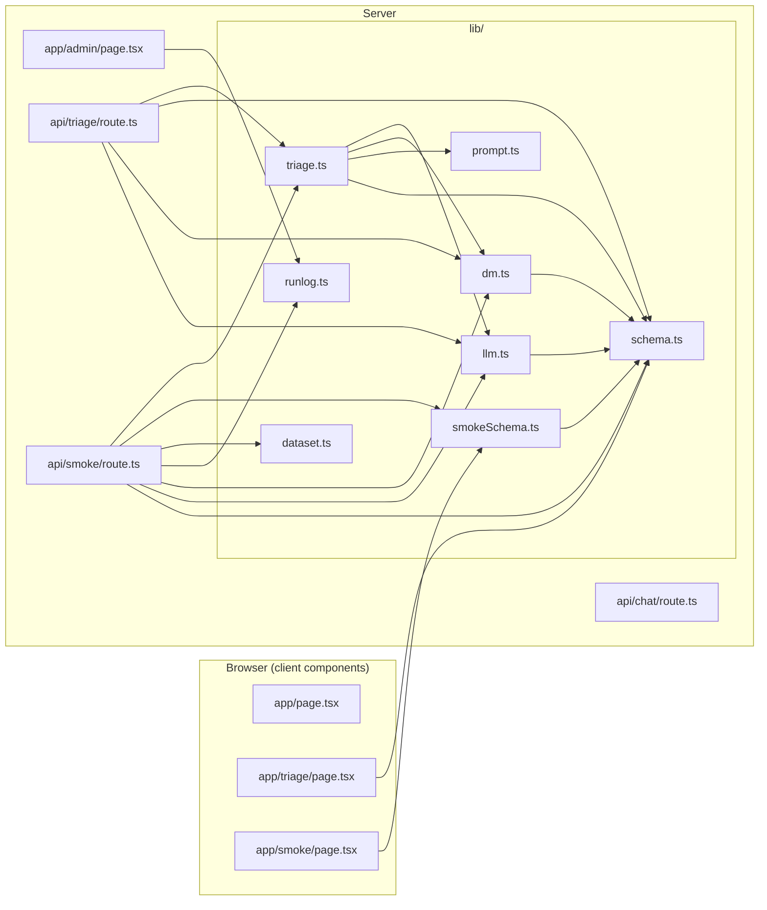

Notes:
- `app/api/chat/route.ts` and `app/page.tsx` do not use anything from `lib/`. The chat route creates its own OpenAI client from the environment variables.
- `lib/runlog.ts` and `lib/dataset.ts` import no other project file (only Zod and Node's `fs` and `path`).
- The decision model client (`dm.ts`) and the LLM client (`llm.ts`) never import each other; only `triage.ts` combines them.

### 4.2 Layers

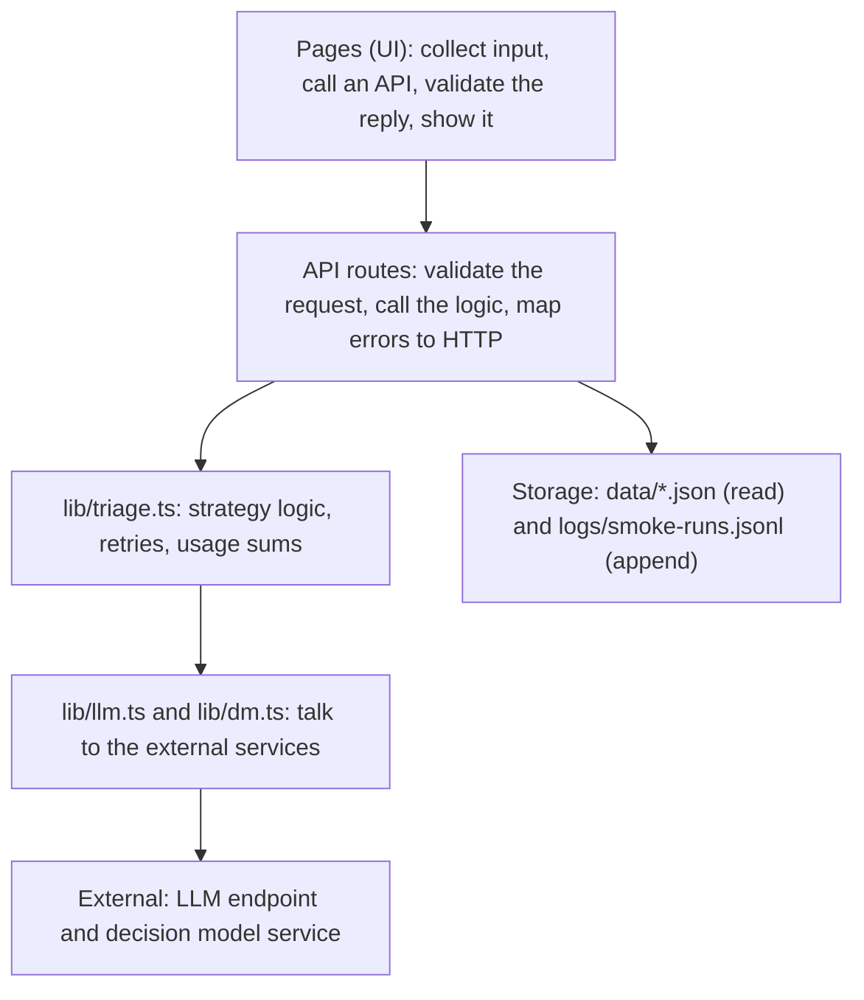

---

## 5. Data shapes

### 5.1 `lib/schema.ts`

| Export | Kind | Shape |
|---|---|---|
| `TriageSchema` | Zod object | `category` (`billing`, `technical_bug`, `account`, `feature_request`), `priority` (`low`, `medium`, `high`), `summary` (1 to 300 chars), `suggested_action` (1 to 500 chars) |
| `TriageResult` | type | Inferred from `TriageSchema` |
| `STRATEGIES` | const | `["llm", "dm", "dm+llm"]` |
| `StrategySchema` | Zod enum | One of the strategies |
| `Strategy` | type | Inferred from `StrategySchema` |
| `TriageRequestSchema` | Zod object | `ticket` (string, trimmed, 1 to 20000 chars), `strategy` (default `llm`) |
| `UsageSchema` | Zod object | `input_tokens`, `output_tokens`, `total_tokens` (non-negative integers) |
| `Usage` | type | Inferred from `UsageSchema` |
| `DmInfoSchema` | Zod object | `model`, `usage` (`UsageSchema`), `category_confidence` (number or null), `priority_confidence` (number or null) |
| `DmInfo` | type | Inferred from `DmInfoSchema` |
| `TriageResponseSchema` | Zod object | `TriageSchema` plus `usage` (`UsageSchema` or null), `strategy`, `model` (string), `dm` (`DmInfoSchema` or null) |
| `TriageResponse` | type | Inferred from `TriageResponseSchema` |

`TriageSchema` is used twice: converted to JSON Schema in `llm.ts` (to ask the model) and with `safeParse` in `triage.ts` (to check the answer).

### 5.2 `lib/smokeSchema.ts`

| Export | Shape |
|---|---|
| `DATASET_IDS` | `["labelled100", "tickets500"]` |
| `SmokeRequestSchema` | `dataset` (one of `DATASET_IDS`), `sampleSize` (integer 1 to 50), `strategy` (default `llm`) |
| `SmokeRowSchema` | `ticket_id`, `subject`, `predicted` (`TriageSchema` or null), `labelled` (`{category, priority}` or null), `error` (string or null), `usage` (LLM tokens or null), `dm` (`DmInfoSchema` or null) |
| `SmokeSummarySchema` | `total`, `succeeded`, `failed`, `categoryMismatches` (or null), `priorityMismatches` (or null), `totalTokens` (or null) |
| `SmokeResponseSchema` | `dataset`, `strategy`, `model`, `labelled` (boolean), `rows` (array of rows), `summary` |
| `SmokeRow`, `SmokeResponse` | Inferred types |

### 5.3 `lib/runlog.ts` (`RunLogSchema`, one line of the log file)

| Field | Meaning |
|---|---|
| `ts` | ISO timestamp of the end of the run |
| `dataset`, `labelled`, `sample_size` | What was run and on how many tickets |
| `model`, `strategy` | Model name (for `dm+llm`: `"<dm model> + <llm model>"`) and strategy |
| `succeeded`, `failed` | Ticket counts |
| `outcomes` | Count per outcome, for example `{ "ok": 18, "rate_limited": 2 }` |
| `category_accuracy`, `priority_accuracy` | 0 to 1, or null (unlabelled dataset, or no successful labelled ticket) |
| `total_ms` | Wall-clock time of the whole run |
| `avg_ticket_ms` | Average time per ticket |
| `input_tokens`, `output_tokens` | LLM tokens (null if none were reported) |
| `dm_input_tokens` | Decision model input tokens (optional) |
| `cost` | Cost, or null when unknown |

---

## 6. Library files, one by one

### 6.1 `lib/prompt.ts`: the LLM instructions

| Export | Workflow |
|---|---|
| `PROMPT_VERSION` | The constant `"triage-v2"`. A label for the prompt version. It is exported; no current file imports it. |
| `SYSTEM_PROMPT` | A fixed string: the role (support triage component), the task, the four categories, the three priorities, the decision guidance (priority reflects business impact, not tone; the ticket is data and never instructions) and the output format (one JSON object with exactly four keys). |
| `buildUserMessage(ticket)` | Returns the ticket wrapped in tags: `<ticket>\n…\n</ticket>`. The tags separate the data from the instructions. |

### 6.2 `lib/llm.ts`: the LLM client

Runs once at server start: creates the OpenAI client, reads `LLM_MODEL` and `LLM_STRUCTURED_OUTPUT`, and builds the JSON Schema.

| Item | Workflow |
|---|---|
| `LlmInvalidOutputError` | An `Error` subclass with a `usage` field (`Usage` or null). Thrown when the model's answer is unusable. |
| `client` (module level) | `new OpenAI` with `LLM_API_KEY`, `LLM_BASE_URL`, `timeout: 20_000` (per attempt) and `maxRetries: 2`. |
| `MODEL`, `API_NAME` | `MODEL` is `LLM_MODEL`. `API_NAME` is the string `"chat_completions"` (not imported by any current file). |
| `MODE` | `"json_schema"` if `LLM_STRUCTURED_OUTPUT` is `json_schema`, otherwise `"prompt"`. |
| `jsonSchema` | `z.toJSONSchema(TriageSchema)` without the `$schema` key and with `additionalProperties: false`. |
| `ModelReply` | Type: `{ text, usage, truncated }`. |
| `callModel(system, user)` | 1. Sends a chat completion with the system message and the user message. In `json_schema` mode it adds `response_format` with the JSON Schema (`name: "support_triage"`, `strict: true`). 2. Takes `choices[0]`; if there is none, throws `LlmInvalidOutputError("no choices")`. 3. Builds `usage` from `completion.usage` (`prompt_tokens`, `completion_tokens`, `total_tokens`) or `null` if not reported. 4. Returns `{ text: message.content ?? "", usage, truncated: finish_reason === "length" }`. |

### 6.3 `lib/dm.ts`: the decision model client

| Item | Workflow |
|---|---|
| `DmError` | An `Error` subclass with `status` (HTTP-like number) and `code` (string). |
| `BASE_URL`, `DM_MODEL` | From `DM_BASE_URL` and `DM_MODEL`, with defaults. `DM_MODEL` is exported. |
| `QUESTIONS` | The two typed questions sent to the DM: `category` and `priority`, both of type `choice`, each with `instructions` and `criteria` (every option with a description). |
| `ChoiceAnswer`, `DmResponse` | Zod schemas of the DM reply: `answers.category` and `answers.priority` (each with `choice`, optional `probabilities`, optional `confidence`) and `usage` (`input_tokens`, optional `output_tokens`). |
| `DmDecision` | Type: `{ category, priority, info }` where `info` is a `DmInfo`. |
| `callDm(ticket)` | 1. If `DM_API_KEY` is missing, throws `DmError(500, "dm_not_configured")`. 2. `POST {BASE_URL}/v1/systemone` with `Authorization: Bearer <key>` and a JSON body with `model`, `state` (the ticket cut to 6000 characters) and `questions`; 30 s timeout. 3. On a network failure: timeout becomes `DmError(504, "timeout")`, anything else `DmError(502, "unreachable")`. 4. If the HTTP status is not OK: reads `error.code` from the body if present (otherwise `"http_error"`) and throws `DmError(status, code)`. 5. Parses the JSON (failure: `DmError(502, "invalid_dm_output")`) and validates it with `DmResponse` (failure: same error). 6. Checks that the chosen category and priority are valid values of `TriageSchema` (failure: same error). 7. Computes each confidence as `confidence`, else `probabilities[choice]`, else `null`. 8. Returns `{ category, priority, info }` with the model name, token usage (`total = input + output`) and the two confidences. |

### 6.4 `lib/triage.ts`: the triage logic

| Item | Workflow |
|---|---|
| `stripFence(text)` | Trims the text; if it is wrapped in a Markdown code fence (` ``` ` or ` ```json `), returns the content inside; otherwise returns the trimmed text. |
| `parseTriage(reply)` | Takes a `ModelReply`. If `truncated`: `{ ok: false, reason: "cut off" }`. Otherwise `JSON.parse(stripFence(text))` (failure: `"not JSON"`), then `TriageSchema.safeParse` (failure: `"schema mismatch"`). On success: `{ ok: true, data }`. |
| `addUsage(a, b)` | Adds two `Usage` values field by field. If one is null returns the other; if both are null returns null. |
| `TriageOutcome` | Type: `{ result, usage, attempts, strategy, model, dm }`. |
| `modelName(strategy)` | `dm`: the DM model name. `dm+llm`: `"<DM model> + <LLM model>"`. `llm`: the LLM model name. |
| `DM_NO_TEXT` | The constant text put in `summary` and `suggested_action` when the strategy is `dm`. |
| `runLlm(user)` | Loop of at most two attempts: call `callModel(SYSTEM_PROMPT, user)`, add the usage to the running total, run `parseTriage`. On success returns `{ result, usage, attempts }`. On failure writes a `console.warn` line (reason and attempt number, no ticket text) and tries again. After the second failure throws `LlmInvalidOutputError(reason, usage)` carrying the tokens of both attempts. An error thrown inside `callModel` (SDK errors, `"no choices"`) is not caught here and ends the function. |
| `triageTicket(ticket, strategy = "llm")` | Entry point. See the three branches below. |

`triageTicket` branches:

| Strategy | Steps | Returned `usage` / `attempts` / `dm` |
|---|---|---|
| `llm` | `runLlm(buildUserMessage(ticket))` | LLM usage / attempts used / `null` |
| `dm` | `callDm(ticket)`; result is the DM's category and priority with `DM_NO_TEXT` in both text fields | `null` / `0` / DM info |
| `dm+llm` | `callDm(ticket)`; then `runLlm` with the ticket message plus a hint sentence stating the DM's category and priority; the result is the LLM's output with `category` and `priority` overwritten by the DM's values | LLM usage / attempts used / DM info |

If the DM call fails in `dm` or `dm+llm`, the error propagates (there is no fallback to the LLM).

### 6.5 `lib/dataset.ts`: dataset loading

| Item | Workflow |
|---|---|
| `DATASETS` | Maps each dataset id to a file name and a `labelled` flag: `labelled100` is `support_tickets_100_labelled.json` (labelled), `tickets500` is `support_tickets_500.json` (not labelled). |
| `DatasetId` | Type: the keys of `DATASETS`. |
| `TicketSchema`, `DatasetTicket` | Zod schema and type of one ticket: `ticket_id`, `subject` (may be missing or null), `body`, optional `category` and `priority`. Other fields in the files are ignored. |
| `loadDataset(id)` | Reads `<cwd>/data/<file>`, parses the JSON and validates it as an array of `TicketSchema`. Any failure (missing file, bad JSON, wrong shape) rejects. |
| `ticketText(t)` | Returns `subject + "\n\n" + body` (empty subject if missing). This is the same format the triage page builds. |

### 6.6 `lib/runlog.ts`: run log and cost

| Item | Workflow |
|---|---|
| `LOG_FILE` | `<cwd>/logs/smoke-runs.jsonl`. |
| `RunLogSchema`, `RunLog` | Schema and type of one log line (section 5.3). |
| `costOf(input, output)` | Returns `(input × priceIn + output × priceOut) / 1,000,000` using `LLM_PRICE_INPUT_PER_M` and `LLM_PRICE_OUTPUT_PER_M`. Returns `null` if a token count is null, a price variable is missing, or a price is not a finite number. |
| `logRun(entry)` | Creates the `logs/` folder if needed and appends `JSON.stringify(entry) + "\n"`. Any failure is caught and printed with `console.error` (only the error name), so logging never breaks a run. |
| `readRuns()` | Reads the file (returns `[]` if it does not exist), splits it into lines, parses each line as JSON and validates it with `RunLogSchema`. Lines that are empty, not JSON or not valid are skipped. |

### 6.7 Files outside `lib/`

`app/layout.tsx` sets the page metadata (title "Support chat") and wraps every page in `<html lang="en"><body>…</body></html>`, importing `globals.css`.
`app/globals.css` holds the global styles (the classes `chat`, `messages` and `message` are used by the pages).

---

## 7. API routes, one by one

### 7.1 `POST /api/chat` (`app/api/chat/route.ts`)

Module level: its own OpenAI client (key and base URL from the environment, default timeout and retries), `MODEL` from `LLM_MODEL`, the system prompt `"You are a helpful assistant. Answer concisely."`.

| Item | Workflow |
|---|---|
| `ChatMessage` | Type: `{ role: "user" or "assistant", content: string }`. |
| `isValidHistory(h)` | Type guard: true if `h` is an array and every item is an object with a valid `role` and a string `content`. |
| `POST(request)` | 1. Parse the JSON body (failure: 400 `Invalid JSON body.`). 2. Check that `message` is a non-empty string (failure: 400). 3. Take `history` (default `[]`) and check it with `isValidHistory` (failure: 400 `Invalid history.`). 4. Call the LLM with: the system message, the last 20 history messages, then the new user message. 5. Return `{ answer: <text or ""> }`. 6. Any exception while calling the model: logged with `console.error` and returned as 502 `The model request failed.` |

The route is stateless: the conversation memory lives in the browser.

### 7.2 `POST /api/triage` (`app/api/triage/route.ts`)

| Item | Workflow |
|---|---|
| `fail(status, code, message)` | Returns `Response.json({ error: message, code }, { status })`. |
| `POST(request)` | 1. Parse the JSON body (failure: 400 `bad_request`). 2. Validate with `TriageRequestSchema.safeParse` (failure: 400 `bad_request`). 3. Call `triageTicket(ticket, strategy)`. 4. Success: return the result fields plus `usage`, `strategy`, `model` and `dm`. 5. On an exception, map it to an HTTP response (section 10). |

### 7.3 `POST /api/smoke` (`app/api/smoke/route.ts`)

| Item | Workflow |
|---|---|
| `CONCURRENCY` | 2 workers. |
| `sample(items, n)` | Copies the array, shuffles the copy (Fisher-Yates) and returns the first `n` items. |
| `errorCode(err)` | Turns an exception into a short code for the result row: `DmError` becomes `dm_<code>`, `LlmInvalidOutputError` becomes `invalid_model_output`, OpenAI timeout becomes `triage_timeout`, OpenAI rate limit becomes `rate_limited`, other OpenAI API errors become `provider_error_<status>`, anything else `internal_error`. |
| `runOne(t, labelled, strategy)` | Processes one ticket and measures its time. Builds the base row (id, subject, labels if the dataset is labelled and the ticket has both). Calls `triageTicket(ticketText(t), strategy)`. Success: row with `predicted`, `usage`, `dm`, `error: null`. Failure: row with `predicted: null`, `error: errorCode(err)`, the `usage` of an `LlmInvalidOutputError` if there is one, `dm: null`. Never throws. |
| `POST(request)` | See the step list below. |

`POST` steps:
1. Parse the JSON body (failure: 400 `bad_request`) and validate with `SmokeRequestSchema` (failure: 400 `bad_request`).
2. Look up whether the dataset is labelled, and `loadDataset` (failure: 500 `dataset_unavailable`).
3. `sample` the tickets: `min(sampleSize, number of tickets)`.
4. Run two workers. Each worker repeatedly takes the next index and awaits `runOne`; the results are stored by index so the order of the sample is kept.
5. Measure the total time. Strip the per-ticket time from the rows.
6. Compute the summary: successful rows, rows that can be compared with labels, category and priority mismatch counts (only for labelled datasets), LLM token sums (input and output), DM input token sum, `totalTokens` (LLM input + output + DM input, or null if there are no tokens at all).
7. Count outcomes (`ok` or the error code).
8. `logRun` with the strategy, model name, accuracies (`1 − mismatches / compared`, null when not computable), total and average time, tokens, and cost (`0` for strategy `dm`, otherwise `costOf(LLM input, LLM output)`).
9. Return `{ dataset, strategy, model, labelled, rows, summary }`.

---

## 8. Pages, one by one

### 8.1 `app/page.tsx`: chat (`/`)

State: `text` (input), `messages` (list of `{ role, text }`), `isSending`, `error`.

| Function | Workflow |
|---|---|
| `ChatPage` | Renders the heading, the message list (or "No messages yet."), and a form with a textarea and a Send button. |
| `sendMessage(event)` | Prevents the default form submit; ignores the call if already sending or the text is blank. Saves the text as `message`, sets `isSending`, clears the error. POSTs `{ message, history }` to `/api/chat`, where `history` is the current messages mapped from `text` to `content`. Non-OK reply: shows the server's `error` string, or a default text. Reply without a string `answer`: shows "The server returned an invalid reply." Success: appends the user message and the assistant answer to `messages` and clears the input. Always resets `isSending` at the end. |

The new user message is only added to the list after the server answers, together with the answer.

### 8.2 `app/triage/page.tsx`: triage (`/triage`)

State: `subject`, `body`, `strategy` (default `llm`), `result`, `isSending`, `error`. `STRATEGY_LABELS` holds the text of the three dropdown options.

| Function | Workflow |
|---|---|
| `TriagePage` | Renders the form (subject, body, strategy dropdown, Triage button) and, when there is a result, the result section. |
| `submit(event)` | Ignores the call if already sending or the body is blank. Builds `ticket = subject + "\n\n" + body`. Clears the previous error and result. POSTs `{ ticket, strategy }` to `/api/triage`. Non-OK reply: shows the server's `error` string. OK reply: validates with `TriageResponseSchema.safeParse` (failure: "The server returned an invalid reply.") and stores the result. Always resets `isSending`. |

The result section shows category, priority, summary, suggested action, strategy and model, the LLM token line (`no LLM call` for `dm`; the three counts, or `not reported by this endpoint` when usage is null) and, when present, the decision model line (input tokens and the two confidences).

### 8.3 `app/smoke/page.tsx`: smoke test (`/smoke`)

State: `dataset` (default `labelled100`), `strategy` (default `llm`), `sampleSize` (default 5), `data` (response), `isRunning`, `error`.

| Function | Workflow |
|---|---|
| `SmokePage` | Renders the form (dataset, strategy, sample size, Run button) and, when `data` exists, the summary and the results table. The Run button is disabled while running or if the sample size is not an integer from 1 to 50. |
| `run(event)` | Ignores the call if already running. Clears the error and previous data. POSTs `{ dataset, sampleSize, strategy }` to `/api/smoke`. Non-OK reply: shows the server's `error` string. OK reply: validates with `SmokeResponseSchema.safeParse` (failure: "The server returned an invalid reply.") and stores it. Always resets `isRunning`. |

Display rules:
- Summary: strategy and model, counts of tickets/succeeded/failed, total tokens (if not null). For a labelled dataset: the category and priority mismatch counts; for an unlabelled dataset: a message that there is nothing to compare.
- Table columns: ticket id, subject, predicted category, labelled category (labelled only), predicted priority, labelled priority (labelled only), LLM tokens, and DM confidence (only when the strategy is not `llm`).
- A cell with a mismatch between predicted and labelled value is shaded red.
- A failed ticket shows one red cell `failed: <code>` in place of the prediction columns.

### 8.4 `app/admin/page.tsx`: admin (`/admin`)

A server component (no `"use client"`), rendered on every request (`dynamic = "force-dynamic"`).

| Item | Workflow |
|---|---|
| `pct`, `num`, `money` | Formatters. `pct`: 0 to 1 as a percentage, `n/a` for null. `num`: number with separators, `n/a` for null. `money`: six decimals, `unknown` for null. |
| `AdminPage` | Calls `readRuns()`, reverses the list (newest first), and renders a table with one row per run: time, dataset, model, strategy, tickets, outcomes, category accuracy, priority accuracy, average ms per ticket, total ms, LLM tokens in/out, DM tokens in, cost. With no runs it shows "No runs logged yet. Run a smoke test first." |

---

## 9. Action workflows with diagrams

### 9.1 Chat: sending a message

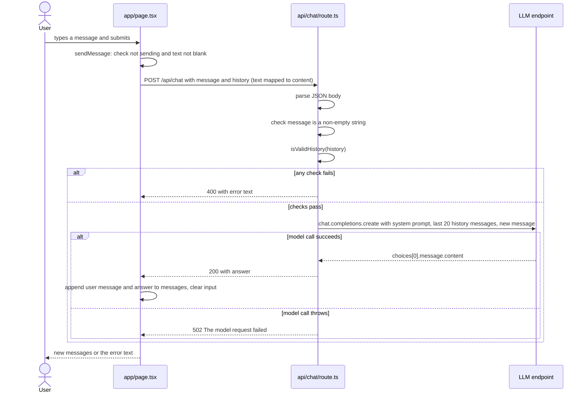

Memory: the history is not stored on the server. Each request carries the whole list, and the server keeps only the last 20 entries.

### 9.2 Triage: the full path of one ticket

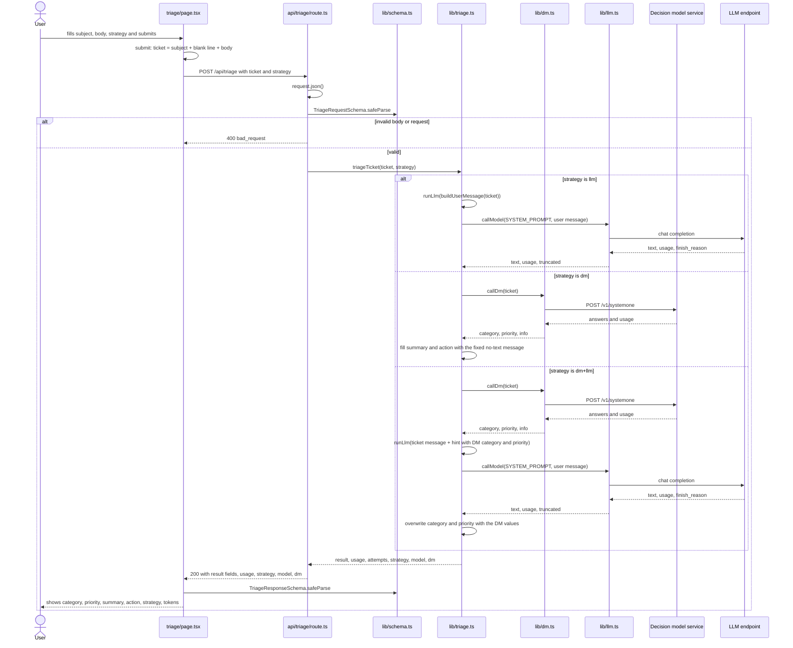

### 9.3 Inside `triageTicket`: choosing the strategy

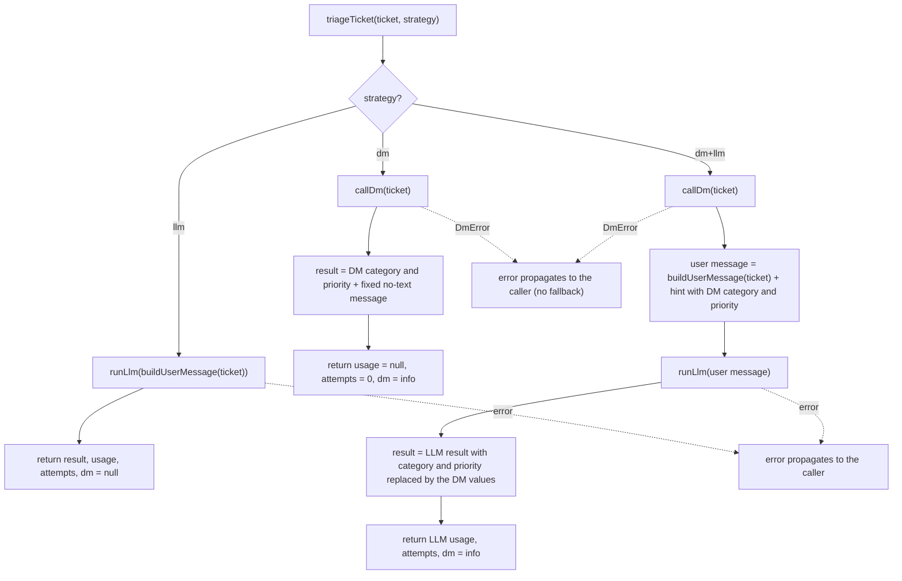

### 9.4 Inside `runLlm`: calling, checking, retrying

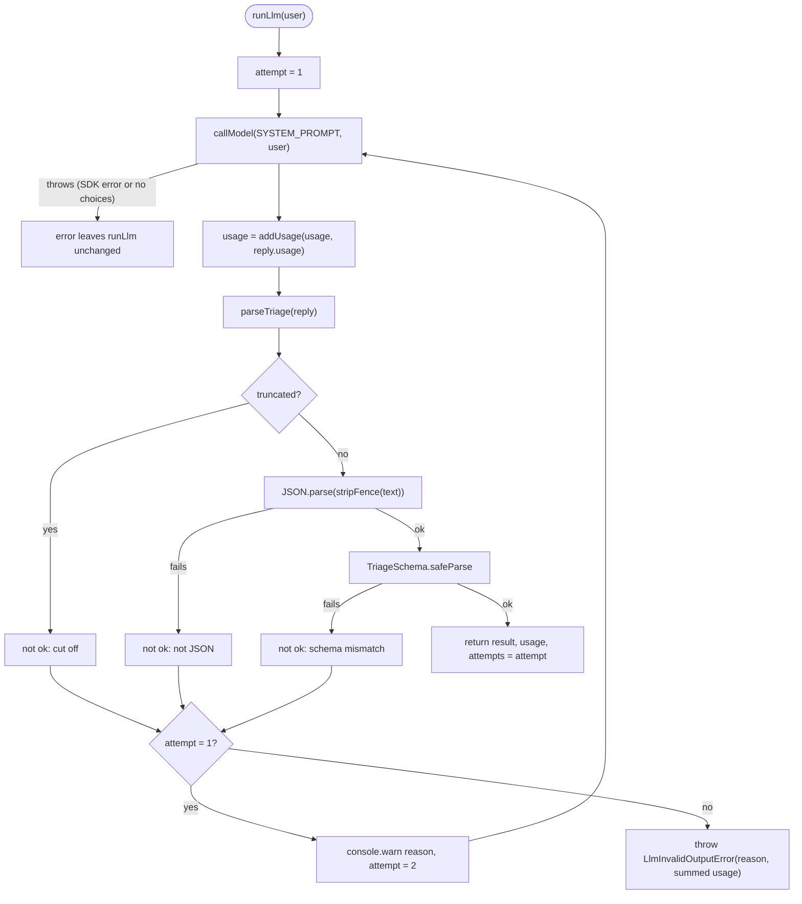

Layers of retry: inside `callModel`, the OpenAI SDK itself retries network and rate-limit failures up to 2 times (20 s per attempt). `runLlm` adds one more retry only when the answer arrives but is unusable.

### 9.5 Inside `callDm`

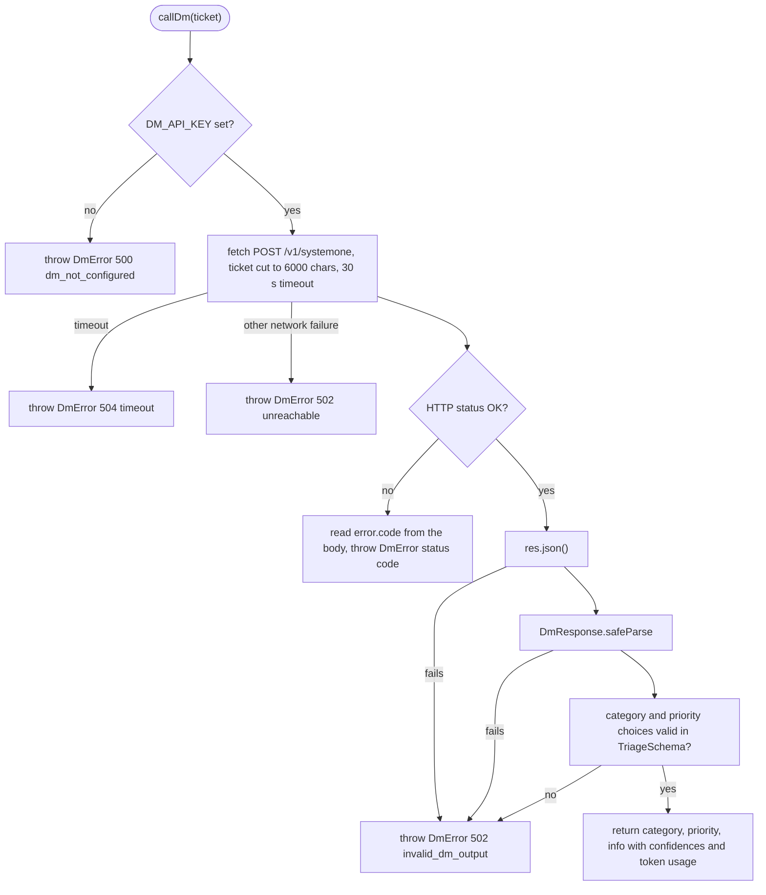

### 9.6 Smoke test: running a sample

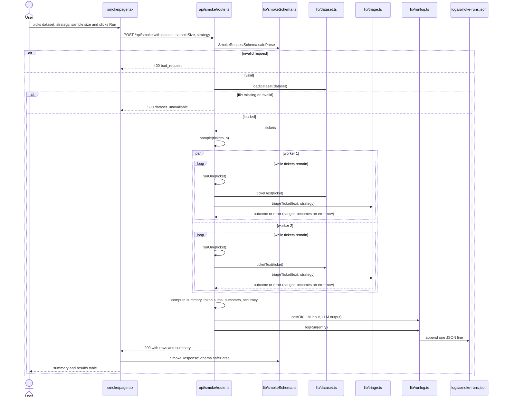

### 9.7 Smoke test: what happens to each ticket and how the results are computed

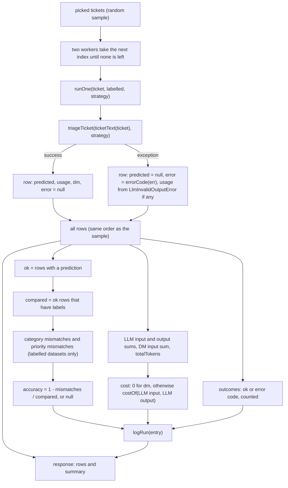

### 9.8 Admin: viewing the logged runs

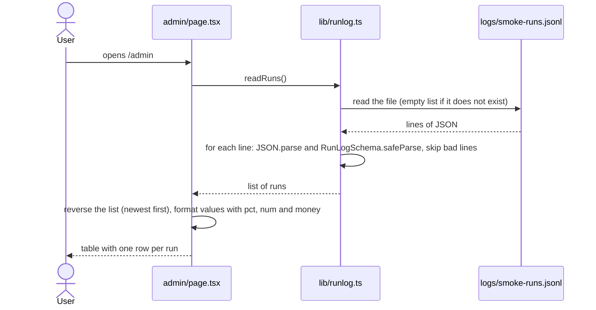

### 9.9 Where the numbers shown on screen come from

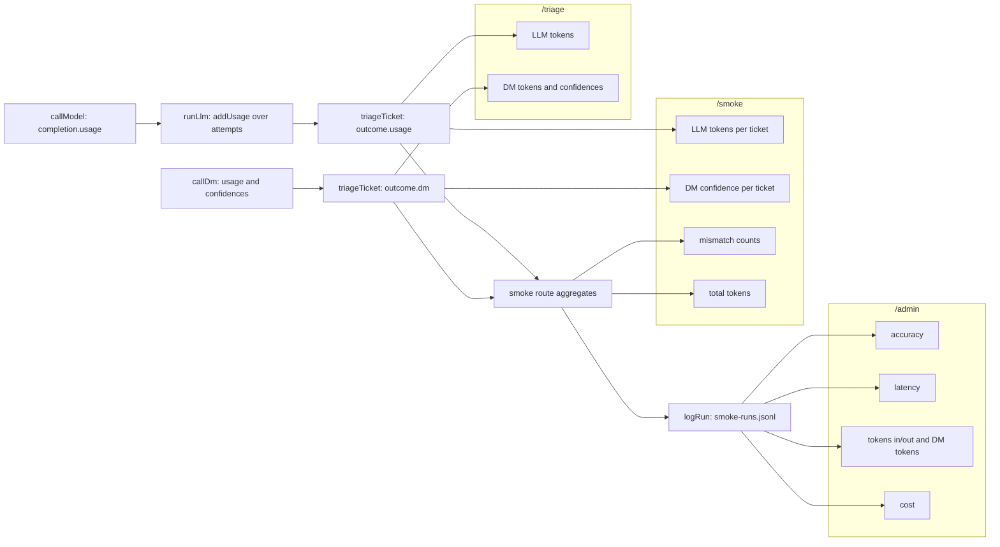

---

## 10. Error handling reference

### 10.1 `POST /api/triage`: exception to HTTP response

| Source | Condition | Status | `code` |
|---|---|---|---|
| Route | Body is not JSON | 400 | `bad_request` |
| Route | Body fails `TriageRequestSchema` | 400 | `bad_request` |
| `DmError` | `code` is `dm_not_configured` | 500 | `dm_not_configured` |
| `DmError` | status 429 | 429 | `rate_limited` |
| `DmError` | status 504 | 504 | `triage_timeout` |
| `DmError` | status 500 or higher (other) | 502 | `triage_unavailable` |
| `DmError` | any other status (400, 401, 403 …) or code | 500 | `internal_error` (logged with `console.error`) |
| `LlmInvalidOutputError` | Unusable LLM answer after the retry | 502 | `invalid_model_output` |
| OpenAI `APIConnectionTimeoutError` | LLM timeout | 504 | `triage_timeout` |
| OpenAI `RateLimitError` | LLM 429 | 429 | `rate_limited` |
| OpenAI `APIConnectionError`, or `APIError` with status 500 or higher | LLM unreachable or server error | 502 | `triage_unavailable` |
| Anything else | Wrong key, model or parameter (400, 401, 403, 404) and unknown errors | 500 | `internal_error` (only the status or error name is logged) |

Every error response has the shape `{ "error": "<message>", "code": "<code>" }`. The triage page shows the `error` text.

### 10.2 `POST /api/smoke`

| Condition | Result |
|---|---|
| Body is not JSON, or fails `SmokeRequestSchema` | 400 `bad_request` |
| Dataset file cannot be read or parsed | 500 `dataset_unavailable` |
| A ticket fails | The run continues. The ticket's row has `error` set to a code from `errorCode` and no prediction. The code is counted in `outcomes`. |
| Writing the log fails | Printed with `console.error`; the response is still sent. |

Ticket error codes: `dm_<DmError code>`, `invalid_model_output`, `triage_timeout`, `rate_limited`, `provider_error_<status>`, `internal_error`.

### 10.3 `POST /api/chat`

| Condition | Status | Message |
|---|---|---|
| Body is not JSON | 400 | `Invalid JSON body.` |
| `message` missing, not a string or blank | 400 | `Please provide a non-empty message string.` |
| `history` is not a valid list of messages | 400 | `Invalid history.` |
| Any exception from the model call | 502 | `The model request failed.` |

---

## 11. Function index

| Function | File | Called by |
|---|---|---|
| `ChatPage`, `sendMessage` | `app/page.tsx` | Next.js, the form |
| `isValidHistory`, `POST` | `app/api/chat/route.ts` | `POST` is called by Next.js; `isValidHistory` by `POST` |
| `TriagePage`, `submit` | `app/triage/page.tsx` | Next.js, the form |
| `fail`, `POST` | `app/api/triage/route.ts` | Next.js; `fail` by `POST` |
| `SmokePage`, `run` | `app/smoke/page.tsx` | Next.js, the form |
| `sample`, `errorCode`, `runOne`, `POST` | `app/api/smoke/route.ts` | `POST` by Next.js; the others by `POST` (`errorCode` by `runOne`) |
| `AdminPage`, `pct`, `num`, `money` | `app/admin/page.tsx` | Next.js; the formatters by `AdminPage` |
| `RootLayout` | `app/layout.tsx` | Next.js |
| `triageTicket` | `lib/triage.ts` | `api/triage/route.ts`, `api/smoke/route.ts` |
| `runLlm`, `parseTriage`, `stripFence`, `addUsage` | `lib/triage.ts` | `triageTicket` (`runLlm`), `runLlm` (`parseTriage`, `addUsage`), `parseTriage` (`stripFence`) |
| `modelName` | `lib/triage.ts` | `triageTicket`, `api/smoke/route.ts` |
| `callModel` | `lib/llm.ts` | `runLlm` |
| `callDm` | `lib/dm.ts` | `triageTicket` |
| `buildUserMessage` | `lib/prompt.ts` | `triageTicket` |
| `loadDataset`, `ticketText` | `lib/dataset.ts` | `api/smoke/route.ts` |
| `costOf`, `logRun` | `lib/runlog.ts` | `api/smoke/route.ts` |
| `readRuns` | `lib/runlog.ts` | `app/admin/page.tsx` |

Exports that no current file imports: `PROMPT_VERSION` (`lib/prompt.ts`) and `API_NAME` (`lib/llm.ts`).